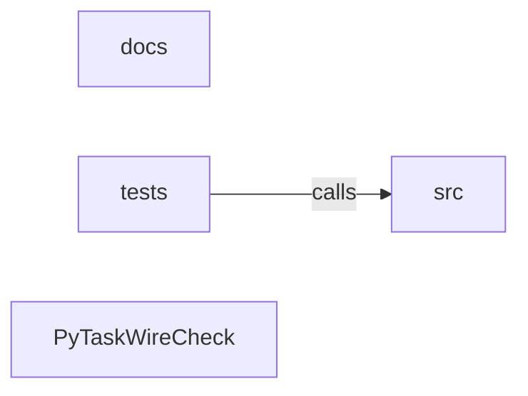

_Generated by CodeAtlas._

## Details

Architecture map of PyTaskWireCheck.

### docs

Owns 0 symbols across 10 file(s).

**Related Classes/Methods:** _None_

### src

Owns 0 symbols across 0 file(s).

**Related Classes/Methods:** _None_

### tests

Owns 175 symbols across 13 file(s).

**Related Classes/Methods:** _None_

**Source Files:**

- `tests/conftest.py`
  - `tests.conftest.make_config`
  - `tests.conftest.make_config._make`
  - `tests.conftest.make_config_file`
  - `tests.conftest.make_config_file._make`
- `tests/test_api.py`
  - `tests.test_api._workflow`
  - `tests.test_api.test_from_file_missing_config_raises`
  - `tests.test_api.test_from_text_validate_and_plan`
  - `tests.test_api.test_functional_run_convenience`
  - `tests.test_api.test_precancelled_token_produces_cancelled_result`
  - `tests.test_api.test_public_exports_are_available`
  - `tests.test_api.test_run_emits_events`
  - `tests.test_api.test_run_executes_all_tasks`
  - `tests.test_api.test_run_max_workers_override_validation`
  - `tests.test_api.test_run_reports_failure`
  - `tests.test_api.test_run_restricts_to_targets_and_dependencies`
  - `tests.test_api.test_unknown_target_raises_graph_error`
- `tests/test_cache.py`
  - `tests.test_cache._run`
  - `tests.test_cache._store`
  - `tests.test_cache._write`
  - `tests.test_cache.test_altered_artifact_is_miss`
  - `tests.test_cache.test_cache_hit_and_reexecution`
  - `tests.test_cache.test_cache_status_and_clean`
  - `tests.test_cache.test_command_change_invalidates`
  - `tests.test_cache.test_concurrent_cache_writes`
  - `tests.test_cache.test_corrupted_metadata_is_miss`
  - `tests.test_cache.test_failed_task_not_cached`
  - `tests.test_cache.test_fingerprint_changes_with_inputs`
  - `tests.test_cache.test_fingerprint_ignores_unrelated_files`
  - `tests.test_cache.test_fingerprint_uses_dependency_keys`
  - `tests.test_cache.test_input_change_invalidates`
  - `tests.test_cache.test_no_cache_mode`
  - `tests.test_cache.test_relevant_env_change_invalidates`
  - `tests.test_cache.test_secrets_not_stored_plaintext`
- `tests/test_cli.py`
  - `tests.test_cli._chdir`
  - `tests.test_cli.test_cache_clean_requires_force`
  - `tests.test_cli.test_cache_status_cli`
  - `tests.test_cli.test_cycle_returns_graph_error`
  - `tests.test_cli.test_explain_json`
  - `tests.test_cli.test_explain_unknown_task`
  - `tests.test_cli.test_graph_dot`
  - `tests.test_cli.test_graph_json`
  - `tests.test_cli.test_graph_text`
  - `tests.test_cli.test_init_creates_config`
  - `tests.test_cli.test_init_refuses_overwrite`
  - `tests.test_cli.test_no_cache_bypasses`
  - `tests.test_cli.test_plan_json`
  - `tests.test_cli.test_run_creates_logs`
  - `tests.test_cli.test_run_failure_exit_code`
  - `tests.test_cli.test_run_json_summary`
  - `tests.test_cli.test_run_subset`
  - `tests.test_cli.test_run_success`
  - `tests.test_cli.test_run_unknown_task`
  - `tests.test_cli.test_second_run_is_cached`
  - `tests.test_cli.test_validate_bad`
  - `tests.test_cli.test_validate_good`
  - `tests.test_cli.test_validate_missing_config`
- `tests/test_config.py`
  - `tests.test_config.test_absolute_output_rejected`
  - `tests.test_config.test_cache_eligible_requires_io`
  - `tests.test_config.test_command_must_be_string_array`
  - `tests.test_config.test_duplicate_dependency_rejected`
  - `tests.test_config.test_empty_command_rejected`
  - `tests.test_config.test_env_values_must_be_strings`
  - `tests.test_config.test_escaping_cwd_rejected`
  - `tests.test_config.test_escaping_output_rejected`
  - `tests.test_config.test_invalid_task_identifier`
  - `tests.test_config.test_legacy_retries_counts_after_first`
  - `tests.test_config.test_max_workers_bounds`
  - `tests.test_config.test_missing_command`
  - `tests.test_config.test_no_tasks`
  - `tests.test_config.test_retry_table`
  - `tests.test_config.test_self_dependency_rejected`
  - `tests.test_config.test_shell_requires_single_element`
  - `tests.test_config.test_shell_single_element_ok`
  - `tests.test_config.test_unknown_task_field`
  - `tests.test_config.test_unknown_top_level_field`
  - `tests.test_config.test_unsupported_version`
  - `tests.test_config.test_valid_config_parses`
  - `tests.test_config.test_version_must_be_int`
- `tests/test_graph.py`
  - `tests.test_graph._graph`
  - `tests.test_graph.test_chain_order`
  - `tests.test_graph.test_closure_includes_dependencies`
  - `tests.test_graph.test_cycle_detected`
  - `tests.test_graph.test_deterministic_order`
  - `tests.test_graph.test_diamond_levels`
  - `tests.test_graph.test_independent_nodes_level0`
  - `tests.test_graph.test_missing_dependency`
  - `tests.test_graph.test_resolve_targets_subset`
  - `tests.test_graph.test_resolve_unknown_target`
  - `tests.test_graph.test_reverse_closure`
  - `tests.test_graph.test_roots_and_leaves`
- `tests/test_history.py`
  - `tests.test_history._run`
  - `tests.test_history.test_history_cli`
  - `tests.test_history.test_history_disabled`
  - `tests.test_history.test_history_without_config`
  - `tests.test_history.test_history_write_failure_does_not_change_exit`
  - `tests.test_history.test_history_write_failure_does_not_change_exit._Boom`
  - `tests.test_history.test_history_write_failure_does_not_change_exit._Boom.record_run`
  - `tests.test_history.test_prune_respects_max_runs`
  - `tests.test_history.test_record_and_read`
- `tests/test_integration.py`
  - `tests.test_integration._config`
  - `tests.test_integration.test_failure_reports_downstream_blocked`
  - `tests.test_integration.test_independent_branches_run_concurrently`
  - `tests.test_integration.test_noninteractive_pipeline`
  - `tests.test_integration.test_pipeline_produces_outputs`
- `tests/test_notifications.py`
  - `tests.test_notifications._Receiver`
  - `tests.test_notifications._Receiver.__enter__`
  - `tests.test_notifications._Receiver.__exit__`
  - `tests.test_notifications._Receiver.__init__`
  - `tests.test_notifications._Receiver.__init__.Handler`
  - `tests.test_notifications._Receiver.__init__.Handler.do_POST`
  - `tests.test_notifications._Receiver.__init__.Handler.log_message`
  - `tests.test_notifications._notification`
  - `tests.test_notifications.test_notification_failure_does_not_change_exit`
  - `tests.test_notifications.test_notifications_enabled_requires_url`
  - `tests.test_notifications.test_run_sends_failure_notification`
  - `tests.test_notifications.test_webhook_delivers_payload`
  - `tests.test_notifications.test_webhook_event_filter_skips`
  - `tests.test_notifications.test_webhook_failure_is_best_effort`
- `tests/test_process_runner.py`
  - `tests.test_process_runner._spec`
  - `tests.test_process_runner.test_arguments_with_spaces_and_unicode`
  - `tests.test_process_runner.test_arguments_with_spaces_and_unicode.cb`
  - `tests.test_process_runner.test_cancellation`
  - `tests.test_process_runner.test_cancellation.canceller`
  - `tests.test_process_runner.test_captures_stdout_and_stderr`
  - `tests.test_process_runner.test_captures_stdout_and_stderr.cb`
  - `tests.test_process_runner.test_environment_override`
  - `tests.test_process_runner.test_environment_override.cb`
  - `tests.test_process_runner.test_large_output`
  - `tests.test_process_runner.test_large_output.cb`
  - `tests.test_process_runner.test_missing_executable`
  - `tests.test_process_runner.test_nonzero_exit`
  - `tests.test_process_runner.test_output_budget`
  - `tests.test_process_runner.test_output_budget.cb`
  - `tests.test_process_runner.test_permission_denied`
  - `tests.test_process_runner.test_shell_opt_in`
  - `tests.test_process_runner.test_successful_command`
  - `tests.test_process_runner.test_timeout`
  - `tests.test_process_runner.test_working_directory`
  - `tests.test_process_runner.test_working_directory.cb`
- `tests/test_scheduler.py`
  - `tests.test_scheduler._ExplodingExecutor`
  - `tests.test_scheduler._ExplodingExecutor.__init__`
  - `tests.test_scheduler._ExplodingExecutor.execute`
  - `tests.test_scheduler._run`
  - `tests.test_scheduler._write_config`
  - `tests.test_scheduler.test_cancellation`
  - `tests.test_scheduler.test_cancellation.canceller`
  - `tests.test_scheduler.test_dependency_ordering`
  - `tests.test_scheduler.test_fail_fast_stops_scheduling`
  - `tests.test_scheduler.test_failure_blocks_dependents`
  - `tests.test_scheduler.test_no_retry_by_default`
  - `tests.test_scheduler.test_parallel_execution`
  - `tests.test_scheduler.test_retry_eventually_succeeds`
  - `tests.test_scheduler.test_scheduler_survives_executor_exception`
  - `tests.test_scheduler.test_timeout_marks_timed_out`
  - `tests.test_scheduler.test_unrelated_branch_continues`
  - `tests.test_scheduler.test_worker_limit_is_respected`
- `tests/test_state.py`
  - `tests.test_state.test_allowed_forward_transition`
  - `tests.test_state.test_illegal_transition_from_terminal`
  - `tests.test_state.test_illegal_transition_pending_to_succeeded`
  - `tests.test_state.test_ready_can_be_cached`
  - `tests.test_state.test_record_transition_updates_status`
  - `tests.test_state.test_terminal_classification`
- `tests/test_tui.py`
  - `tests.test_tui._TTY`
  - `tests.test_tui._TTY.isatty`
  - `tests.test_tui._feed`
  - `tests.test_tui.test_render_reflects_events`
  - `tests.test_tui.test_render_truncates_to_terminal_size`
  - `tests.test_tui.test_start_and_stop_on_tty`
  - `tests.test_tui.test_start_noop_when_isatty_raises`
  - `tests.test_tui.test_start_noop_when_isatty_raises._Broken`
  - `tests.test_tui.test_start_noop_when_isatty_raises._Broken.isatty`
  - `tests.test_tui.test_start_noop_when_not_a_tty`
  - `tests.test_tui.test_write_swallows_broken_pipe`
  - `tests.test_tui.test_write_swallows_broken_pipe._Closed`
  - `tests.test_tui.test_write_swallows_broken_pipe._Closed.write`

### PyTaskWireCheck

Owns 0 symbols across 8 file(s).

**Related Classes/Methods:** _None_
