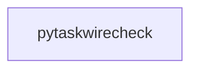

_Generated by CodeAtlas._

## Details

Owns 0 symbols across 0 file(s).

### pytaskwirecheck

Owns 38 symbols across 4 file(s).

**Related Classes/Methods:** _None_

**Source Files:**

- `src/pytaskwirecheck/api.py`
  - `src.pytaskwirecheck.api.Workflow`
  - `src.pytaskwirecheck.api.Workflow.__init__`
  - `src.pytaskwirecheck.api.Workflow._failed_tasks`
  - `src.pytaskwirecheck.api.Workflow._notify`
  - `src.pytaskwirecheck.api.Workflow._record_history`
  - `src.pytaskwirecheck.api.Workflow._resolve_execution`
  - `src.pytaskwirecheck.api.Workflow.config`
  - `src.pytaskwirecheck.api.Workflow.from_file`
  - `src.pytaskwirecheck.api.Workflow.from_text`
  - `src.pytaskwirecheck.api.Workflow.graph`
  - `src.pytaskwirecheck.api.Workflow.plan`
  - `src.pytaskwirecheck.api.Workflow.run`
  - `src.pytaskwirecheck.api.Workflow.validate`
  - `src.pytaskwirecheck.api.load_workflow`
  - `src.pytaskwirecheck.api.plan`
  - `src.pytaskwirecheck.api.run`
  - `src.pytaskwirecheck.api.validate`
- `src/pytaskwirecheck/cli.py`
  - `src.pytaskwirecheck.cli._color_enabled`
  - `src.pytaskwirecheck.cli._err`
  - `src.pytaskwirecheck.cli._failed_tasks`
  - `src.pytaskwirecheck.cli._graph_dot`
  - `src.pytaskwirecheck.cli._graph_text`
  - `src.pytaskwirecheck.cli._load`
  - `src.pytaskwirecheck.cli._prepare_graph`
  - `src.pytaskwirecheck.cli._record_history`
  - `src.pytaskwirecheck.cli._resolve_config_path`
  - `src.pytaskwirecheck.cli._send_notifications`
  - `src.pytaskwirecheck.cli.build_parser`
  - `src.pytaskwirecheck.cli.cmd_cache_clean`
  - `src.pytaskwirecheck.cli.cmd_cache_status`
  - `src.pytaskwirecheck.cli.cmd_explain`
  - `src.pytaskwirecheck.cli.cmd_graph`
  - `src.pytaskwirecheck.cli.cmd_history`
  - `src.pytaskwirecheck.cli.cmd_init`
  - `src.pytaskwirecheck.cli.cmd_plan`
  - `src.pytaskwirecheck.cli.cmd_run`
  - `src.pytaskwirecheck.cli.cmd_validate`
  - `src.pytaskwirecheck.cli.main`
